# Package Turbo – Benutzerdokumentation

Package Turbo ist eine Neuimplementierung des Package Handlers (Release 2022) des Schweizerischen Bundesarchivs (BAR) mit Python, PySide6 und QML. Diese Dokumentation folgt im Aufbau der Benutzerdokumentation des Package Handlers (Version 1.9, November 2024). Die Abbildungen stammen aus der aktuellen Implementierung und zeigen das KOST-CECO-Testpaket `SIP_20220328_KOST_eCH1.2G_1a-3d-IO`; sie werden mit `tools/doc_screenshots.py` neu erstellt.

Texte in dunkelroter Farbe beschreiben Funktionen, die (noch) nicht umgesetzt sind oder sich vom Original-Package-Handler unterscheiden.

## Inhaltsverzeichnis

1. [Einleitung](#1-einleitung)
2. [Erste Schritte mit Package Turbo](#2-erste-schritte-mit-package-turbo)
3. [Form und Struktur einer digitalen Ablieferung: Das digitale Paket](#3-form-und-struktur-einer-digitalen-ablieferung-das-digitale-paket)
4. [Paket öffnen](#4-paket-öffnen)
5. [Paket speichern](#5-paket-speichern)
6. [Paket / Package Turbo schliessen](#6-paket--package-turbo-schliessen)
7. [Benutzeroberfläche](#7-benutzeroberfläche)
8. [Ablieferung vorbereiten](#8-ablieferung-vorbereiten)
9. [Metadaten bearbeiten](#9-metadaten-bearbeiten)
10. [Ablieferung prüfen und korrigieren](#10-ablieferung-prüfen-und-korrigieren)
11. [Darstellung von Vorgängen und Aktivitäten](#11-darstellung-von-vorgängen-und-aktivitäten)
12. [Darstellung von Mappen](#12-darstellung-von-mappen)
13. [Metadaten suchen](#13-metadaten-suchen)
14. [Weitere Werkzeuge für die Bearbeitung der Ablieferung](#14-weitere-werkzeuge-für-die-bearbeitung-der-ablieferung)
15. [Berichte erstellen](#15-berichte-erstellen)
16. [Package Turbo einrichten](#16-package-turbo-einrichten)
17. [Tabellenspalten konfigurieren und sortieren](#17-tabellenspalten-konfigurieren-und-sortieren)
18. [Tabellen nach Excel exportieren](#18-tabellen-nach-excel-exportieren)
19. [Hilfe](#19-hilfe)
20. [Übersicht Befehle](#20-übersicht-befehle)
21. [Objekte in Package Turbo](#21-objekte-in-package-turbo)

---

## 1. Einleitung

### 1.1 Zweck des Dokuments

Die Benutzerdokumentation beschreibt den Aufbau und die Funktionen von Package Turbo, einer Applikation für die Erstellung, Bearbeitung und Prüfung von digitalen Ablieferungen, die als Informationspakete (Submission Information Package, SIP) an ein Archiv übergeben werden. Sie richtet sich an abliefernde Stellen und an Archivarinnen und Archivare, die digitale Ablieferungen übernehmen und prüfen.

Die Anforderungen des BAR an digitale Ablieferungen sind in der *Spezifikation Submission Information Package (SIP)* beschrieben und werden in diesem Dokument nicht vollständig wiedergegeben.

### 1.2 Zweck von Package Turbo

Package Turbo unterstützt die Erstellung, Qualitätsprüfung und Sichtung von digitalen Ablieferungen gemäss dem Standard eCH-0160 – Archivische Ablieferungsschnittstelle. Die Metadaten des Pakets (`header/metadata.xml`) können gesichtet, erstellt und bearbeitet werden; die Primärdaten (Dateien im Ordner `content`) lassen sich direkt öffnen. Zusätzlich stehen Funktionen zur Prüfung der Metadaten, zur Suche, für Notizen und Stichproben zur Verfügung.

Package Turbo öffnet und prüft Pakete der Standardversionen eCH-0160 v1.0, v1.1 und v1.2 (XML-Namensraum `http://bar.admin.ch/arelda/v4`). Die Prüfung erfolgt jeweils gegen die XSD-Dateien, die im Paket im Ordner `header/xsd` mitgeliefert werden. Neue Pakete werden nach eCH-0160 v1.2 (Schema-Version 5.0) erstellt.

Wie im Original werden die Attribute *version*, *repraesentation*, *information* und *reihung* von `<dateiRef>` nicht angezeigt.

### 1.3 Sprache der Applikation

Package Turbo ist auf Deutsch und Französisch verfügbar. Die Sprache wird unter *Extras → Benutzervorgaben* gewählt und nach einem Neustart wirksam.

Abweichung: In der französischen Version sind derzeit nur Menüs, Dialoge und Schaltflächen übersetzt. Bezeichnungen von Metadatenfeldern, Registern, Prüfungen, Validierungsmeldungen und Berichten erscheinen weiterhin auf Deutsch.

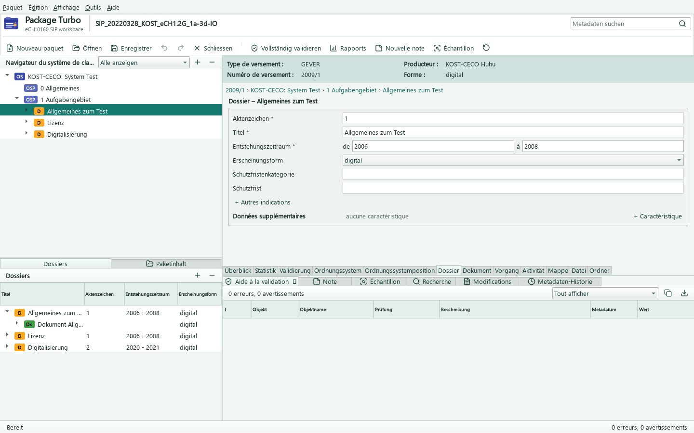

### 1.4 Aufbau der Benutzerdokumentation

Kapitel 2 erläutert die ersten Schritte. Kapitel 3 bis 6 erklären die Struktur eines Pakets sowie das Öffnen, Speichern und Schliessen. Kapitel 7 gibt eine Übersicht über die Benutzeroberfläche. Die Kapitel 8 bis 10 behandeln die Erstellung, Prüfung und Korrektur einer Ablieferung, die Kapitel 11 bis 21 unterstützende Funktionen.

### 1.5 Verwendete Symbole und Beschreibungselemente

Befehle in Menüs, Toolbar und Dialogen sind *kursiv* gesetzt. Menüpfade werden verkürzt dargestellt: *Paket → Paket öffnen...* bedeutet, dass zuerst das Menü *Paket* und danach der Eintrag *Paket öffnen...* gewählt wird.

> **Tipp:** Hinweise mit nützlichen Informationen sind so gekennzeichnet.

---

## 2. Erste Schritte mit Package Turbo

### 2.1 Systemvoraussetzungen

Package Turbo läuft unter Windows, macOS und Linux mit Python 3.11 oder neuer. Benötigt werden die Pakete PySide6 (ab 6.9) und lxml.

Abweichung: Das Original basiert auf Eclipse RCP und Java (Amazon Corretto). Package Turbo benötigt keine Java-Laufzeitumgebung.

### 2.2 Package Turbo starten

| Aktion | Vorgehen |
|---|---|
| Installation | Im Projektordner `pip install -e .` ausführen (einmalig). |
| Starten | `python main.py` oder `package-turbo` ausführen. |
| Paket direkt öffnen | Den SIP-Ordner als Argument übergeben: `python main.py <SIP-Ordner>`. |

Abweichung: Package Turbo wird derzeit nicht als fertige ZIP-Applikation ausgeliefert. Die Konfiguration für eine eigenständige Applikation (`pyside6-deploy`) ist vorbereitet, aber noch nicht erprobt.

Nach dem Start erscheint das Hauptfenster ohne geöffnetes Paket:

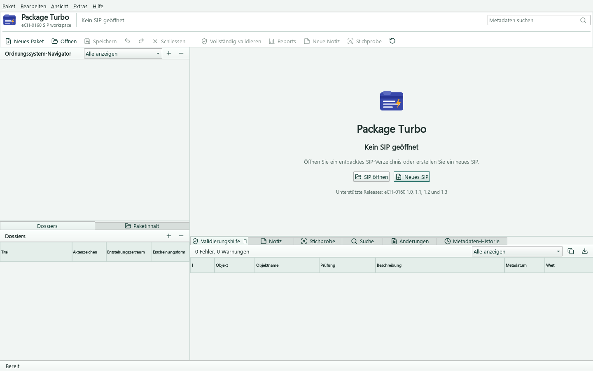

---

## 3. Form und Struktur einer digitalen Ablieferung: Das digitale Paket

Pro Ablieferung wird ein SIP gebildet. Ein SIP besteht aus einem Ordner (Toplevel-Ordner) mit genau zwei Unterordnern:

- **header** enthält die Datei `metadata.xml` mit den Metadaten der Ablieferung sowie den Ordner `xsd` mit den XML-Schemas.
- **content** enthält die Primärdaten, d. h. alle Unterlagen, die an das Archiv abgeliefert werden.

Der Name des Toplevel-Ordners folgt dem Muster `SIP_[Ablieferungsdatum JJJJMMTT]_[Abliefernde Stelle]_[Referenz]`.

---

## 4. Paket öffnen

### 4.1 Paket öffnen

| Aktion | Vorgehen |
|---|---|
| Paket öffnen | In der Toolbar *Paket öffnen* oder im Menü *Paket → Paket öffnen...* wählen und den Toplevel-Ordner des SIP auswählen. |
| Per Drag & Drop | Den Toplevel-Ordner aus dem Explorer in den leeren Editorbereich ziehen. |
| Gültigkeitsprüfung | Ist das Paket nicht vollständig valide, erscheint die Meldung *Gültigkeitsprüfung fehlgeschlagen*. Mit *OK* weiterfahren. |
| Vollständige Validierung | Beim Öffnen wird eine vollständige Validierung angeboten (*OK* startet sie). Bei grossen Paketen kann diese einige Zeit dauern. |
| Paket schreibgeschützt öffnen | Im Menü *Paket → Paket schreibgeschützt öffnen...* wählen. Das Paket kann dann nicht bearbeitet werden. |
| Erneutes Öffnen | Im Menü *Paket* werden das aktuelle und die drei zuletzt geöffneten Pakete angezeigt. |

Abweichung: Die Liste der zuletzt geöffneten Pakete bleibt auch nach einem Neustart erhalten. Drag & Drop ist nur möglich, solange kein Paket geöffnet ist.

Nach dem Öffnen zeigt der Editor das Register *Überblick*:

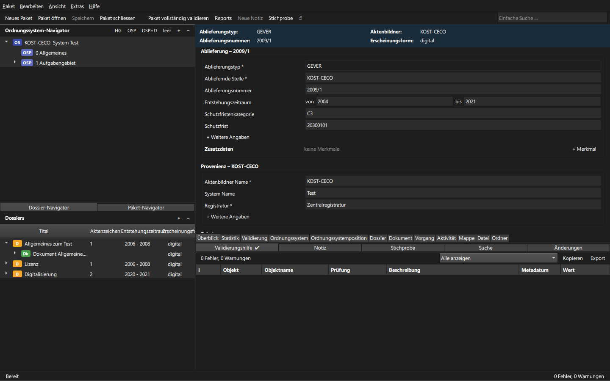

### 4.2 Die Datei metadata.xml öffnen

Mit *Paket → metadata.xml öffnen...* kann eine einzelne Datei `metadata.xml` geöffnet werden.

- Liegt die Datei im Ordner `header` eines SIP, wird das ganze SIP geöffnet und kann bearbeitet werden.
- Liegt sie ausserhalb eines SIP, können die Metadaten nur gesichtet werden. Prüfungen, die die Primärdaten betreffen, sind dann nicht möglich.

Abweichung: Eine `metadata.xml` ausserhalb eines SIP wird immer schreibgeschützt geöffnet (das Original rät nur davon ab, sie zu bearbeiten).

### 4.3 Fehlermeldungen beim Öffnen eines Pakets

| Grund | Fehlermeldung |
|---|---|
| Fehlende Entität | Explizite Meldung, z. B. *Fehlende Entität: Das metadata.xml enthält keine \<ablieferung\>.* |
| XML nicht lesbar / Zeichenkodierung verletzt | Meldung mit Zeilennummer und Fehlerbeschreibung des XML-Parsers. |
| Kein gültiges Paket | *Beim selektierten Ordner handelt es sich um kein gültiges Paket* (z. B. wenn der Ordner `header` oder die Datei `metadata.xml` fehlt). |

Ist das XML lesbar, aber nicht XSD-konform, wird das Paket geöffnet; die XSD-Fehler erscheinen in der Validierungshilfe unter der Prüfung *Allgemein*.

Abweichung: Es gibt keinen Dialog mit der Schaltfläche *Details >>*; die Details stehen direkt in der Meldung bzw. in der Validierungshilfe.

---

## 5. Paket speichern

| Aktion | Vorgehen |
|---|---|
| Paket speichern | Toolbar *Speichern*, Menü *Paket → Speichern* oder `Ctrl+S`. |
| Paket als ZIP speichern | Menü *Paket → Paket zippen...*. |
| Speichern beim Schliessen | Wurden Metadaten geändert, wird beim Schliessen des Pakets oder von Package Turbo nachgefragt, ob gespeichert werden soll (*Speichern*, *Verwerfen*, *Abbrechen*). |

Abweichung: Alle Funktionen, die das Dateisystem verändern (Import, Umbenennen, Löschen, Ersetzen, Normalisieren und Korrekturen aus der Validierungshilfe), speichern das Paket sofort, damit Primär- und Metadaten übereinstimmen. Dabei werden auch zuvor vorgenommene, noch nicht gespeicherte Änderungen gespeichert. Im Original gilt dies nur für das Ersetzen von Dateien.

### 5.1 Datei mit den Metadaten exportieren

Mit *Paket → metadata.xml exportieren...* wird eine Kopie der Metadaten an einem Ort ausserhalb des SIP gespeichert. Weitere Änderungen werden im geöffneten Paket gespeichert, nicht in der exportierten Datei.

---

## 6. Paket / Package Turbo schliessen

| Aktion | Vorgehen |
|---|---|
| Paket schliessen | Toolbar *Paket schliessen*, Menü *Paket → Paket schliessen* oder `Ctrl+W`. |
| Meldung beim Schliessen | Enthält das Paket noch Fehler, wird darauf hingewiesen. *OK* schliesst das Paket trotzdem, *Abbrechen* lässt es geöffnet. |
| Package Turbo schliessen | Menü *Paket → Beenden* oder das Fenster schliessen. |
| Nachfrage bei Änderungen | Bei ungespeicherten Änderungen wird nachgefragt, ob gespeichert werden soll. |

Es ist immer nur ein Paket geöffnet. Wird ein weiteres Paket geöffnet oder erstellt, wird das aktuelle geschlossen.

Abweichung: Um ein anderes Paket anzuschauen, muss Package Turbo nicht neu gestartet werden.

---

## 7. Benutzeroberfläche

Die Benutzeroberfläche besteht aus Menüleiste und Toolbar, den Navigatoren (links), dem Metadaten-Editor (rechts oben) und den Aktionsviews (rechts unten). Eine Statusleiste zeigt die letzte Aktion sowie die Anzahl Fehler und Warnungen.

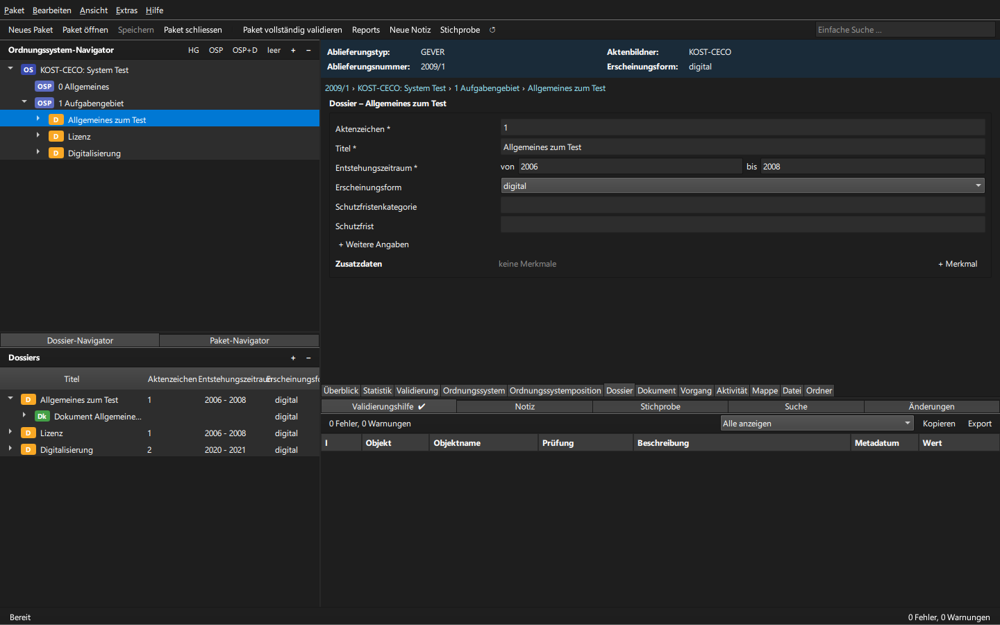

### 7.1 Menüleiste, Toolbar und Viewmenü

Die **Menüleiste** enthält:

- *Paket*: Neues Paket, Öffnen, Speichern, ZIP, metadata.xml öffnen/exportieren, *Reports*, Schliessen, zuletzt geöffnete Pakete, Beenden.
- *Bearbeiten*: Rückgängig, Ausschneiden, Kopieren und Einfügen in Textfeldern.
- *Ansicht*: Perspektiven speichern, öffnen, löschen und zurücksetzen; Maximierung aufheben.
- *Extras*: Suche, Paket vollständig validieren, Zeiträume auf Ablieferung kumulieren, *Normalisierung*, Stichprobe, *Benutzervorgaben*.
- *Hilfe*: Benutzerdokumentation, Tastenbelegung, Über Package Turbo.

Die **Toolbar** enthält Neues Paket, Paket öffnen, Speichern, Paket schliessen, Paket vollständig validieren, Reports, Neue Notiz, Stichprobe, Perspektive zurücksetzen (↺) und das Feld für die einfache Suche.

Das **Viewmenü** der Navigatoren befindet sich in deren Titelzeile: Filter (z. B. *HG*, *OSP*, *OSP+D*, *leer*) sowie *+* (Alles aufklappen) und *−* (Alles zuklappen).

Abweichung: Die Befehle der Toolbar und des Viewmenüs sind als Text statt als Icons dargestellt. *Ausschneiden/Kopieren/Einfügen* stehen nicht in der Toolbar, sondern im Menü *Bearbeiten* und im Kontextmenü der Textfelder.

### 7.2 Grundelemente der Benutzeroberfläche

| Element | Aktion |
|---|---|
| Trennlinien | Durch Ziehen der Trennlinien wird die Grösse der Bereiche verändert. |
| Fenster maximieren | Doppelklick auf den Titel eines Navigators, auf die Kopfzeile des Editors oder auf das Register *Validierungshilfe* maximiert den Bereich; erneuter Doppelklick stellt ihn wieder her. |
| Ansicht wiederherstellen | *Ansicht → Maximierung aufheben* bzw. *Perspektive zurücksetzen*. |
| Bildlaufleisten | Erscheinen, wenn nicht alle Informationen sichtbar sind. |

Abweichung: Navigatoren und Aktionsviews können nicht geschlossen, abgedockt oder per Drag & Drop an eine andere Position verschoben werden.

### 7.3 Editor

Im Editor sind die Metadaten in thematischen Registern zusammengefasst. Alle Register haben folgende Elemente:

1. **Kopfzeile** mit Ablieferungstyp, Aktenbildner, Ablieferungsnummer und Erscheinungsform. Die Erscheinungsform wird aus den Dokumenten hergeleitet (*keine Angabe*, wenn das SIP keine Dokumente enthält). Ein `*` vor der Ablieferungsnummer zeigt ungespeicherte Änderungen an.
2. **Pfad** aus Links zum gewählten Objekt (siehe 7.6).
3. **Detail** mit den Metadaten. Ein Teil der Metadaten befindet sich unter *+ Weitere Angaben*; am Ende folgen die *Zusatzdaten* (siehe 7.3.5).
4. **Register** am unteren Rand des Editors.
5. **Tooltip Register**: Beschreibung der thematischen Gruppe beim Überfahren eines Registers.
6. **Tooltip Metadaten**: Beschreibung des Metadatums (und allfälliger Fehler) beim Überfahren der Feldbezeichnung.

Pflichtfelder sind mit `*` markiert. Fehlende Pflichtangaben und Felder mit Validierungsfehlern werden rot dargestellt.

Abweichung: Die Register liegen am unteren Rand des Editors. Die Tooltips enthalten nur für die wichtigsten Metadaten eine Beschreibung, da die XSD-Dateien keine Beschreibungstexte enthalten.

#### 7.3.1 Metadaten im Editor

Register: *Überblick*, *Statistik*, *Validierung*, *Ordnungssystem*, *Ordnungssystemposition*, *Dossier* (auch Subdossiers), *Dokument*, *Vorgang*, *Aktivität*, *Mappe*, *Datei*, *Ordner*.

Nicht umgesetzt: Es gibt kein Register *Archivische Vorgänge*.

#### 7.3.2 Metadaten zur Identifikation der Ablieferung

Das Register *Überblick* zeigt die Metadaten zur **Ablieferung**, zur **Provenienz** und zum **Paket**.

#### 7.3.3 Metadaten zum Ordnungssystem und zu den Ordnungssystempositionen

Die Register *Ordnungssystem* und *Ordnungssystemposition* zeigen das jeweils zuletzt in einem Navigator gewählte Objekt. Damit Metadaten angezeigt werden, muss das Objekt einmal selektiert worden sein.

#### 7.3.4 Metadaten zu Dossiers, Dokumenten, Vorgängen, Aktivitäten, Mappen, Dateien und Ordnern

Die entsprechenden Register zeigen das zuletzt gewählte Objekt des jeweiligen Typs. Welche Felder angezeigt werden, richtet sich nach dem XSD des Pakets (GEVER oder FILES, Standardversion).

#### 7.3.5 Element Zusatzdaten

Das Metadatenfeld *Zusatzdaten* ist ein generisches Feld, in dem weitere deskriptive Metadaten als Merkmale (Name und Wert) erfasst werden können. Es steht bei *Paket*, *Ablieferung*, *Ordnungssystem*, *Ordnungssystemposition*, *Dossier*, *Dokument*, *Vorgang*, *Aktivität* und *Mappe* zur Verfügung und erscheint im Editor am Ende des jeweiligen Bereichs.

| Aktion | Vorgehen |
|---|---|
| Merkmal hinzufügen | *+ Merkmal* klicken, Name und Wert eingeben. Das Merkmal wird beim Verlassen des Feldes übernommen. |
| Merkmal ändern | Name oder Wert im Feld ändern. |
| Merkmal entfernen | ✕ am Ende der Zeile klicken. Wird das letzte Merkmal entfernt, wird das Element *Zusatzdaten* gelöscht. |

Zusatzdaten werden in der Aktionsview *Änderungen* aufgeführt und von der einfachen und erweiterten Suche berücksichtigt. Bei Vorgängen und Aktivitäten sind sie nur sichtbar, nicht bearbeitbar.

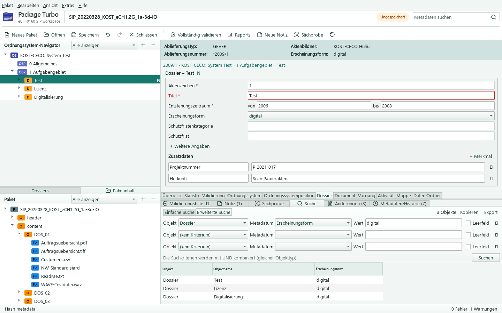

Abweichung: Das Original weist darauf hin, dass *Zusatzdaten* bei Ablieferungen an das BAR nicht verwendet werden dürfen. Package Turbo setzt diese Vorgabe bewusst nicht um: Zusatzdaten können überall erfasst werden, wo das XSD sie vorsieht, und lösen keine Validierungsmeldung aus. Bei der *Provenienz* sieht das XSD keine Zusatzdaten vor.

### 7.4 Navigatoren

#### 7.4.1 Ordnungssystem-Navigator

Der Ordnungssystem-Navigator zeigt das gesamte Ordnungssystem mit Ordnungssystempositionen, Dossiers, Subdossiers, Dokumenten, Mappen und den zugewiesenen Dateien. Über die Dateien hat man Zugang zu den Primärdaten.

#### 7.4.2 Metadaten zum Ordnungssystem

| Aktion | Vorgehen |
|---|---|
| Baum pro Hierarchiestufe öffnen / schliessen | Klick auf die Pfeile im Baum. |
| Baum ganz öffnen / schliessen | *+* (Alles aufklappen) bzw. *−* (Alles zuklappen) in der Titelzeile. |
| Nur Hauptgruppen | Filter *HG*. |
| Nur Ordnungssystempositionen | Filter *OSP*, danach *+*. |
| Nur OSP mit untergeordneten Dossiers | Filter *OSP+D*, danach *+*. |
| Nur leere Dossiers | Filter *leer*, danach *+*. Bei leeren Subdossiers wird auch das übergeordnete Dossier angezeigt. |

Damit eine gültige Ablieferung erstellt werden kann, muss sie mindestens eine Ordnungssystemposition enthalten.

Abweichung: Die Filter wirken einzeln (ein Klick auf einen anderen Filter ersetzt den aktiven). Die Kombination von *OSP+D* und *OSP* ist bereits im Filter *OSP+D* enthalten. Ein Shift-Klick auf einen Pfeil öffnet den Baum nicht bis zur untersten Stufe.

#### 7.4.3 Dossier-Navigator

Der Dossier-Navigator zeigt alle Dossiers mit ihrem Inhalt (Subdossiers, Dokumente, Vorgänge, Aktivitäten, Mappen, Dateien) als Baum mit den Spalten Aktenzeichen, Entstehungszeitraum und Erscheinungsform.

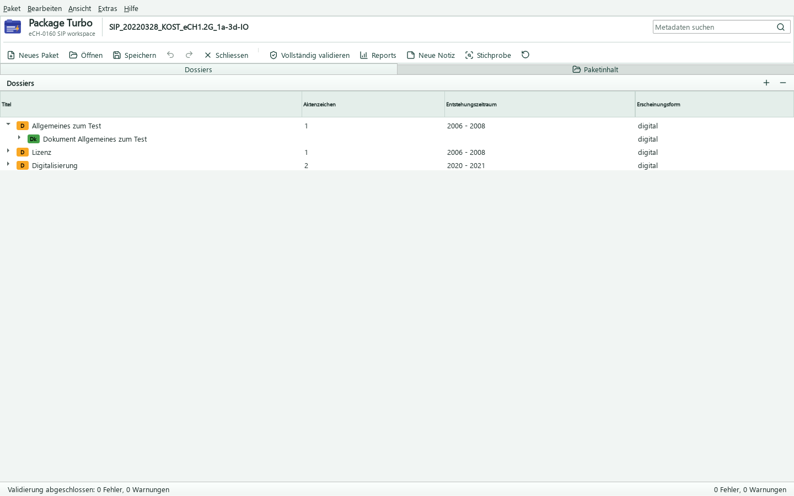

#### 7.4.4 Metadaten zu Dossiers und den enthaltenen Unterlagen

Der Baum wird mit den Pfeilen bzw. *+* und *−* geöffnet und geschlossen. Selektierte Zeilen können über das Kontextmenü in die Zwischenablage kopiert werden (siehe Kapitel 18).

#### 7.4.5 Paket-Navigator

Der Paket-Navigator zeigt das Dateisystem des Pakets mit den Ordnern `header` und `content`. Hier werden die Primärdaten für eine Ablieferung vorbereitet (siehe Kapitel 8.2).

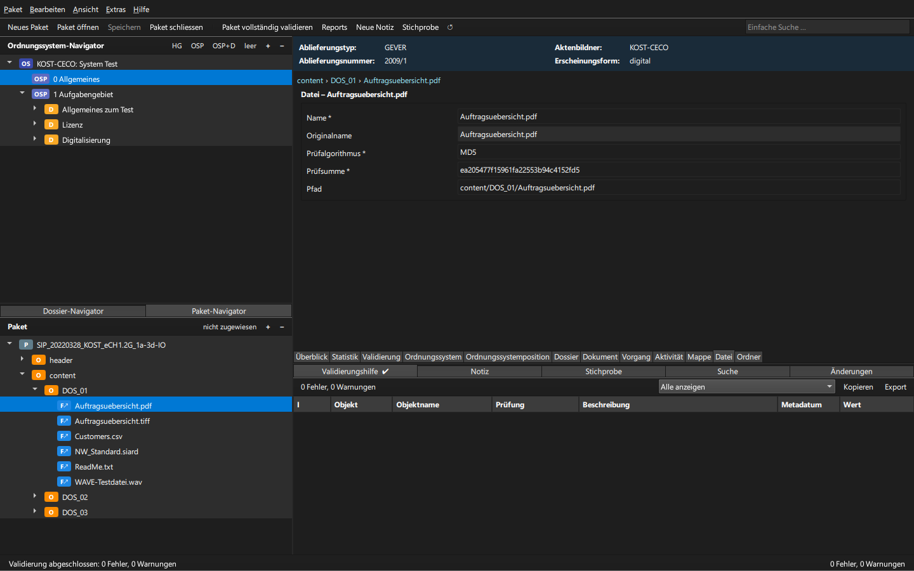

#### 7.4.6 Metadaten zu Ordnern und Dateien

| Aktion | Vorgehen |
|---|---|
| Baum ganz öffnen / schliessen | *+* bzw. *−* in der Titelzeile. |
| Baum pro Hierarchiestufe öffnen / schliessen | Klick auf die Pfeile. |
| Nicht zugewiesene Dateien anzeigen | Filter *nicht zugewiesen* aktivieren, danach *+*. Nicht zugewiesene Dateien werden rot und kursiv dargestellt. |

Im Editor werden nur die Metadaten der Dateien und Ordner des Paket-Navigators angezeigt.

### 7.5 Metadaten zu einem Objekt anzeigen

- **Von einem Navigator aus:** Ein Klick auf ein Objekt zeigt im Editor das zugehörige Register.
- **Von einer Aktionsview aus:** Ein Doppelklick auf eine Zeile zeigt das Objekt im Editor und markiert es im Navigator.

### 7.6 Angewähltes Objekt im Editor im Ordnungssystem identifizieren

Die Register der Objekte zeigen einen Pfad aus Links (z. B. *2009/1 › KOST-CECO: System Test › 1 Aufgabengebiet › Allgemeines zum Test*). Ein Klick auf einen Bestandteil zeigt das entsprechende Objekt im Editor und markiert es im Navigator.

### 7.7 Anzeige der Objekte in den Navigatoren einschränken

Bei sehr grossen Ablieferungen wird *Alles aufklappen* automatisch deaktiviert, wenn ein Navigator mehr Objekte enthält als der Schwellwert. Der Schwellwert (Standard 15 000) wird unter *Extras → Benutzervorgaben → Navigatoren* festgelegt.

Abweichung: Es gibt einen gemeinsamen Schwellwert für alle Navigatoren statt je einen pro Navigator.

### 7.8 Aktionsviews: Validierungshilfe, Notiz, Stichprobe, Suche, Änderungen

| Aktionsview | Inhalt |
|---|---|
| *Validierungshilfe* | Fehler und Warnungen der Validierung mit Beschreibung und Funktionen zur Fehlerbehebung. Das Register zeigt ✖ und die Anzahl Fehler bzw. ✔, wenn keine Fehler vorliegen. |
| *Notiz* | Erfasste Notizen mit Objekt, Datum und Verfasser. |
| *Stichprobe* | Zufällig ausgewählte Dossiers. |
| *Suche* | Resultate der einfachen und der erweiterten Suche. |
| *Änderungen* | Änderungen an den Metadaten seit dem letzten Speichern. |

### 7.9 Primärdaten in Navigatoren und Aktionsviews

Dateien werden mit dem Standardprogramm des Betriebssystems geöffnet:

- in den Navigatoren mit Doppelklick auf die Datei oder über das Kontextmenü *Datei zeigen*;
- in den Aktionsviews mit Doppelklick auf die Zeile (das Objekt wird im Navigator markiert) und danach *Datei zeigen*.

Abweichung: Die Aktionsviews haben keinen eigenen Befehl *Datei zeigen*; Dateien werden über den Navigator geöffnet.

---

## 8. Ablieferung vorbereiten

Bei der Erstellung einer Ablieferung wird im Paket-Navigator die Ordnerstruktur mit den Dateien erstellt und im Ordnungssystem-Navigator das Ordnungssystem. Änderungen im Paket-Navigator wirken sich direkt auf das Dateisystem aus; Änderungen im Ordnungssystem-Navigator betreffen nur die Metadaten.

### 8.1 Erste Schritte für die Erstellung der Ablieferung

#### 8.1.1 Neues Paket erstellen

| Aktion | Vorgehen |
|---|---|
| 1. Neues Paket erstellen | Toolbar *Neues Paket*, Menü *Paket → Neues Paket erstellen...* oder `Ctrl+N`. |
| 2. XSD-Version | Die verwendete Version wird angezeigt (eCH-0160 v1.2, arelda v4, Schema-Version 5.0). |
| 3. Angaben erfassen | Ablieferungstyp (GEVER/FILES), abliefernde Stelle, Referenz, optional Aktenbildner und Name des Ordnungssystems. |
| 4. Paket benennen | Der SIP-Name wird aus Datum, abliefernder Stelle und Referenz vorgeschlagen und kann angepasst werden. |
| 5. Speicherort | Mit *Durchsuchen...* den Speicherort wählen. |
| 6. Fertigstellen | *Fertigstellen* erstellt das Paket mit Ordnungssystem und einer Ordnungssystemposition und öffnet es. |

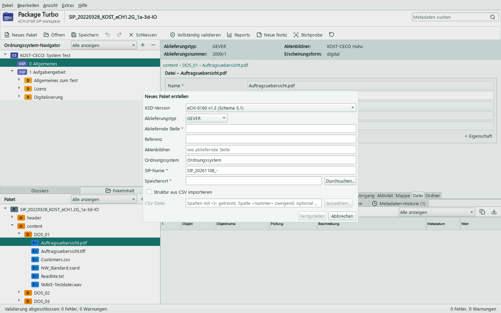

Abweichung: Alle Angaben werden in einem einzigen Dialog statt in mehreren Schritten (*Weiter*) erfasst. Es steht nur eine XSD-Version zur Auswahl. Ein neuer Ordner für den Speicherort wird im Ordnerdialog des Betriebssystems angelegt.

#### 8.1.2 Neues Paket erstellen und eine Struktur importieren

Beim Erstellen eines Pakets kann eine CSV-Datei mit Ordnungssystempositionen und Dossiers importiert werden:

1. Die Datei enthält in der ersten Zeile eine Kopfzeile mit der zwingenden Spalte `nummer` (Nummer der Ordnungssystemposition bzw. Aktenzeichen des Dossiers).
2. Die optionale Spalte `type` enthält `ordnungssystemposition` (Standard) oder `dossier`.
3. Alle Textattribute von Ordnungssystemposition und Dossier können als weitere Spalten verwendet werden (z. B. `titel`).
4. Die Spalten sind mit `|` getrennt.
5. Im Dialog *Neues Paket erstellen* das Kästchen *Struktur aus CSV importieren* aktivieren und die Datei auswählen.

Die Hierarchie wird nach der Logik der freien Zehnergliederung gebildet: Ein Eintrag wird unter dem Eintrag mit der längsten Nummer angelegt, die ein Präfix seiner eigenen Nummer ist (Punkte und Leerzeichen werden dabei ignoriert). Einträge mit identischer Nummer liegen auf derselben Stufe. Die Reihenfolge der CSV-Datei wird übernommen.

#### 8.1.3 Fehlermeldung beim Erstellen eines neuen Pakets

| Aktion | Vorgehen |
|---|---|
| SIP-Name entspricht nicht der Spezifikation | Der Name wird rot dargestellt und die Abweichung angezeigt; *Fertigstellen* ist gesperrt. Die Prüfung kann unter *Extras → Benutzervorgaben* deaktiviert werden. |
| SIP-Name enthält unerlaubte Zeichen | Erlaubt sind `A–Z a–z 0–9 _ . -`. |
| CSV-Datei kann nicht importiert werden | Meldung mit Zeilennummer; das teilweise erstellte Paket wird wieder entfernt. |

### 8.2 Ordnerstruktur mit den Primärdaten (Dateien) erstellen

#### 8.2.1 Bestehende Ablagen in Paket-Navigator importieren

| Aktion | Vorgehen |
|---|---|
| Per Drag & Drop | Den Ordner aus dem Explorer auf den Paket-Navigator ziehen. Er wird in den dort selektierten Ordner (z. B. `content`) importiert. |
| Über das Kontextmenü | Rechtsklick auf einen Ordner → *Ordner importieren...* bzw. *Dateien importieren...*. |
| Ordner zusammenführen | Existieren Ordner oder Dateien bereits, wird einmal nachgefragt: *Ja* führt zusammen und ersetzt gleichnamige Dateien, *Nein* überspringt vorhandene Objekte, *Abbrechen* bricht ab. |

Für jede importierte Datei wird die Prüfsumme (MD5) berechnet und im Inhaltsverzeichnis eingetragen.

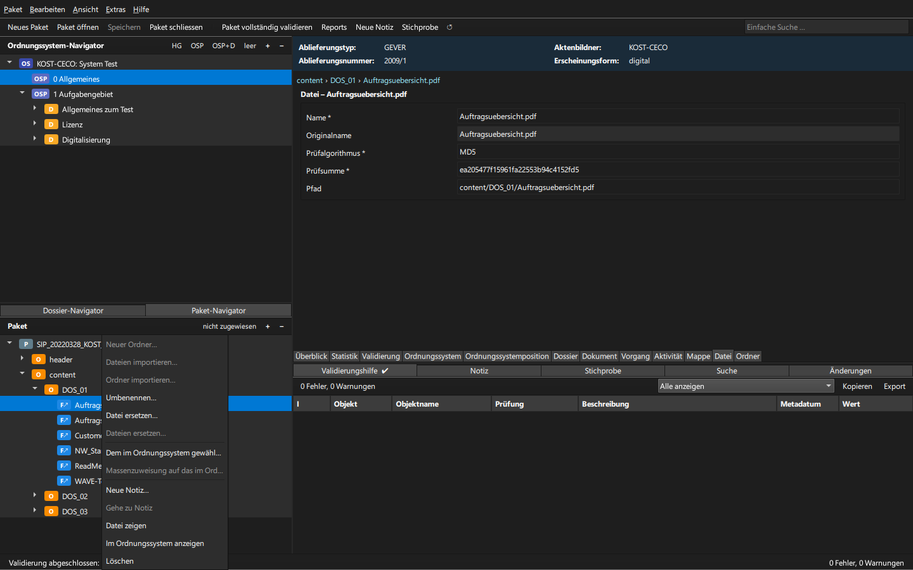

Abweichung: Beim Zusammenführen wird nur einmal für alle Ordner gefragt (kein *Auf alle Ordner anwenden* pro Ordner).

#### 8.2.2 Ordnerstruktur im Paket-Navigator erstellen

Rechtsklick auf einen Ordner in `content` → *Neuer Ordner...* und den Namen eingeben. Der Name darf keine unerlaubten Zeichen enthalten.

#### 8.2.3 Primärdaten (Dateien) integrieren

Dateien aus dem Explorer auf den Paket-Navigator ziehen oder über *Dateien importieren...* auswählen. Sie werden in den selektierten Ordner eingefügt.

#### 8.2.4 Primärdaten (Ordner und Dateien) umbenennen und löschen

| Aktion | Vorgehen |
|---|---|
| Umbenennen | Rechtsklick → *Umbenennen...*. Der ursprüngliche Name bleibt im Metadatum *Originalname* erhalten. |
| Löschen | Rechtsklick → *Löschen* oder Taste `Entf`. Ordner werden mit allen enthaltenen Ordnern und Dateien gelöscht; die Zuweisungen der Dateien im Ordnungssystem werden entfernt. |

#### 8.2.5 Fehlermeldung beim Umbenennen von Primärdaten

Enthält der neue Name unerlaubte Zeichen oder existiert bereits ein Objekt mit diesem Namen, wird eine Meldung angezeigt und nicht umbenannt.

#### 8.2.6 Eine Datei (Primärdatei) im Paket ersetzen

Rechtsklick auf eine Datei → *Datei ersetzen...* und die neue Datei wählen (der Name muss nicht übereinstimmen). Die Prüfsumme wird angepasst; Name und übrige Metadaten bleiben erhalten. Das Paket wird anschliessend gespeichert.

#### 8.2.7 Mehrere Dateien (Primärdaten) im Paket ersetzen

Rechtsklick auf die oberste Zeile (Paket) → *Dateien ersetzen...* und den Ordner mit den Ersatzdateien wählen. Die gefundenen gleichnamigen Dateien werden aufgelistet und nach Bestätigung ersetzt. Werden keine gleichnamigen Dateien gefunden, erscheint eine Meldung.

### 8.3 Metadaten erstellen

#### 8.3.1 Ordnungssystem anhand der Ordnerstruktur im Paket-Navigator erstellen

| Aktion | Vorgehen |
|---|---|
| 1. Ordner und Ziel wählen | Im Paket-Navigator die Ordner selektieren. Im Ordnungssystem-Navigator das Ziel (Ordnungssystem, OSP oder Dossier) selektieren und im Kontextmenü *Massenzuweisung der im Paket-Navigator gewählten Ordner...* wählen. Alternativ im Paket-Navigator *Massenzuweisung auf das im Ordnungssystem gewählte Objekt...*. |
| 2. Struktur festlegen | *Anzahl OSP Stufen* und *Anzahl Dossier Stufen* eingeben; optional *Erzeuge Dokumente für Dateien* und *Obersten Ordner zuweisen*. |
| 3. Fertigstellen | *Fertigstellen* erstellt die Struktur. Die Zuweisung kann nur durch Löschen der Struktur im Ordnungssystem-Navigator aufgehoben werden. |

Ordner bis zur Stufe *Anzahl OSP Stufen* werden zu Ordnungssystempositionen, die folgenden Stufen zu Dossiers und Subdossiers. Dateien werden dem nächsten Dossier zugewiesen. Bei GEVER-Ablieferungen wird pro Datei ein Dokument erstellt, da GEVER-Dossiers Dateien nur über Dokumente enthalten dürfen.

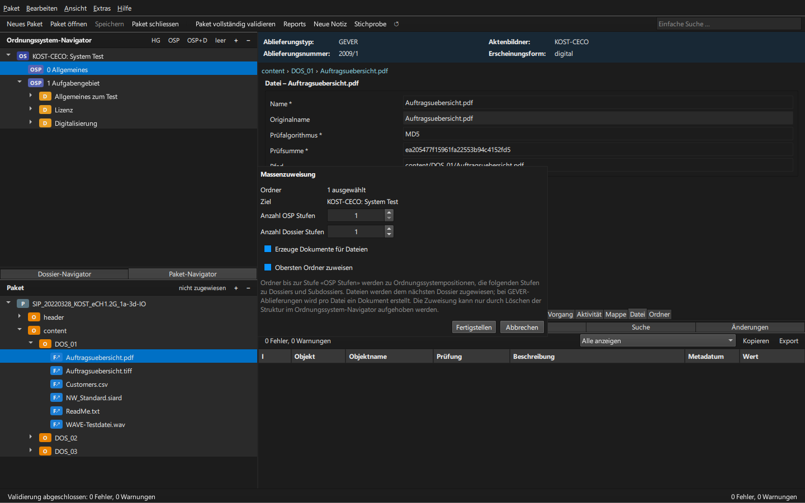

Abweichung: Die Ordner werden nicht per Drag & Drop, sondern über das Kontextmenü zugewiesen. Es gibt keine Vorschau des Vorschlags (*Zuweisen*, *Zuweisung löschen*), keine Stufenanzeige und keine Anpassung pro Ordner. Die Anzahl nicht zugewiesener Dateien wird nach dem Fertigstellen gemeldet.

#### 8.3.2 Fehlermeldungen bei der Massenzuweisung

| Fall | Meldung |
|---|---|
| Keine OSP Stufe bei Zuweisung auf das Ordnungssystem | Die Struktur muss mindestens eine Ordnungssystemposition enthalten. |
| OSP-Stufen unter einer OSP mit Dossiers | Unter einer Ordnungssystemposition mit Dossiers können keine OSP Stufen erstellt werden (das Feld ist nicht gesperrt, die Zuweisung wird aber abgelehnt). |
| Dossiers neben OSP | Dossiers können nicht neben Ordnungssystempositionen angelegt werden. |
| Dateien nicht vollständig zugewiesen | Die Anzahl nicht zugewiesener Dateien wird gemeldet. |

Abweichung: Bereits zugewiesene Dateien werden bei einer erneuten Zuweisung an dasselbe Objekt nicht doppelt zugewiesen; an andere Objekte können sie erneut zugewiesen werden.

#### 8.3.3 Ordnungssystem mit Dossiers, Dateien und Dokumenten im Ordnungssystem-Navigator erstellen

Rechtsklick auf ein Element im Ordnungssystem-Navigator:

| Befehl | Wirkung |
|---|---|
| *Neue Ordnungssystemposition* / *Mehrere neue Ordnungssystempositionen...* | unter dem Ordnungssystem oder einer OSP (nicht unter einer OSP mit Dossiers) |
| *Neues Dossier* / *Mehrere neue Dossiers...* | unter einer OSP der untersten Stufe oder unter einem Dossier (Subdossier) |
| *Neues Dokument* / *Mehrere neue Dokumente...* | unter einem Dossier oder Subdossier |
| *Neue Mappe* | unter dem Ordnungssystem, einer OSP oder einem Dossier |
| *Neues Dokument für diese Datei* | auf einer direkt einem Dossier zugewiesenen Datei |
| *Neue Dokumente für die enthaltenen Dateien* | auf einem Dossier |

Nicht anwendbare Befehle sind ausgegraut. Neue Objekte erhalten eine Nummer bzw. ein Aktenzeichen, einen Standardtitel und die im XSD vorgeschriebenen Angaben (z. B. Entstehungszeitraum *keine Angabe*).

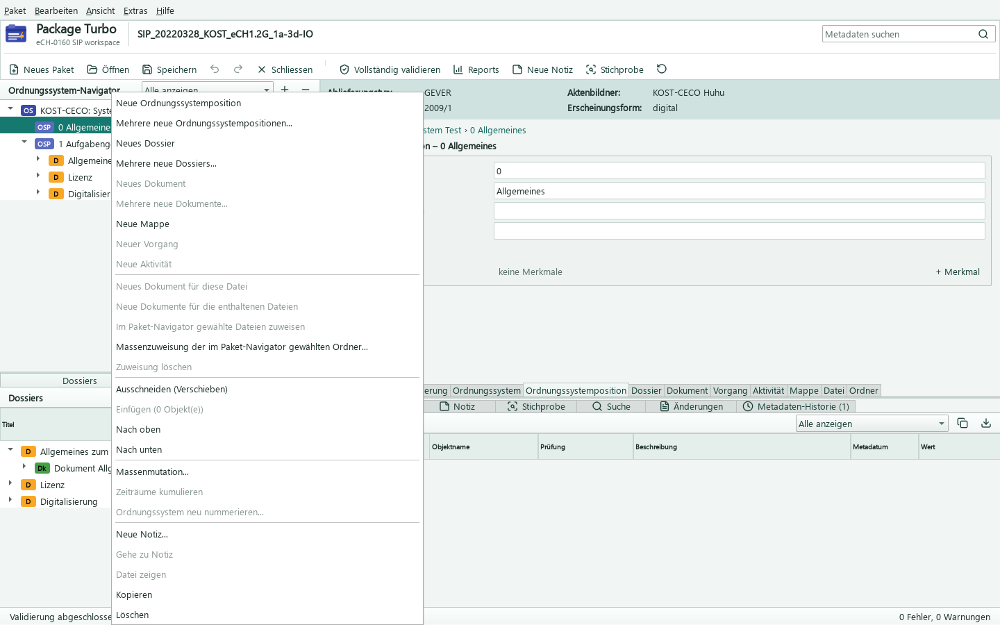

#### 8.3.4 Objekte im Ordnungssystem-Navigator verschieben

1. Rechtsklick auf das Objekt (oder mehrere selektierte Objekte) → *Ausschneiden (Verschieben)*.
2. Rechtsklick auf das Ziel → *Einfügen (n Objekt(e))*.
3. Innerhalb derselben Stufe: *Nach oben* bzw. *Nach unten*.

Eine vorhandene Nummerierung wird nach dem Verschieben nicht automatisch angepasst.

Abweichung: Objekte werden über *Ausschneiden/Einfügen* und *Nach oben/Nach unten* statt per Drag & Drop verschoben.

#### 8.3.5 Objekte im Ordnungssystem-Navigator löschen

Rechtsklick → *Löschen* oder Taste `Entf`. Das Objekt wird mit allen darunterliegenden Elementen gelöscht (nach Bestätigung). Mehrere Objekte werden mit `Ctrl`+Klick oder `Shift`+Klick selektiert. Wird eine Datei im Ordnungssystem-Navigator gelöscht (*Zuweisung löschen*), wird nur die Zuweisung entfernt.

#### 8.3.6 Dateien dem Ordnungssystem zuweisen

1. Im Paket-Navigator die Dateien selektieren.
2. Im Ordnungssystem-Navigator Rechtsklick auf das Ziel-Dossier, -Dokument oder die Mappe → *Im Paket-Navigator gewählte Dateien zuweisen*. Alternativ im Paket-Navigator *Dem im Ordnungssystem gewählten Objekt zuweisen*.

Zugewiesene Dateien sind im Paket-Navigator mit einem Pfeil auf dem Symbol gekennzeichnet (`F↗`), nicht zugewiesene rot und kursiv.

Abweichung: Dateien werden über das Kontextmenü statt per Drag & Drop zugewiesen.

#### 8.3.7 Ordnungssystem nummerieren

Rechtsklick auf das Ordnungssystem → *Ordnungssystem neu nummerieren...* und die Gliederungsvariante wählen:

- **Freie Zehnergliederung**: höchstens 10 Positionen pro Stufe (0–9); die Nummer einer Position ist die Nummer der übergeordneten Position plus eine Ziffer (z. B. `1`, `10`, `101`).
- **Gliederung mit 1 bis 100 Positionen**: höchstens 100 Positionen pro Stufe (`00`–`99`).

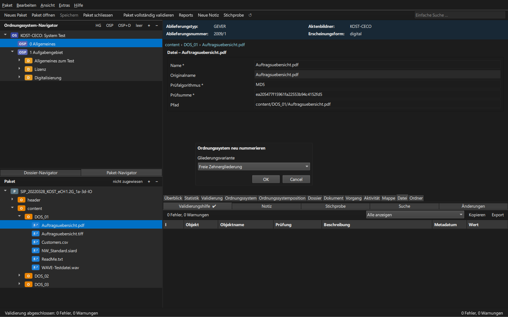

---

## 9. Metadaten bearbeiten

### 9.1 Metadaten eingeben und ändern

| Aktion | Vorgehen |
|---|---|
| Textfelder bearbeiten | In das Feld klicken und den Inhalt ändern. Die Änderung wird beim Verlassen des Feldes übernommen. Gesperrte Felder sind grau hinterlegt. |
| Änderungen rückgängig machen | Rechtsklick ins Feld → *Rückgängig* (solange das Feld bearbeitet wird). |
| Ausschneiden, Kopieren, Einfügen, Löschen | Text markieren, Rechtsklick → *Ausschneiden*, *Kopieren*, *Einfügen* oder *Löschen*; oder Menü *Bearbeiten*. |
| Wertelisten bearbeiten | Felder mit festgelegten Werten (z. B. Erscheinungsform, Datenschutz, Prüfalgorithmus) werden über eine Auswahlliste bearbeitet. Die Werte stammen aus dem XSD des Pakets. |

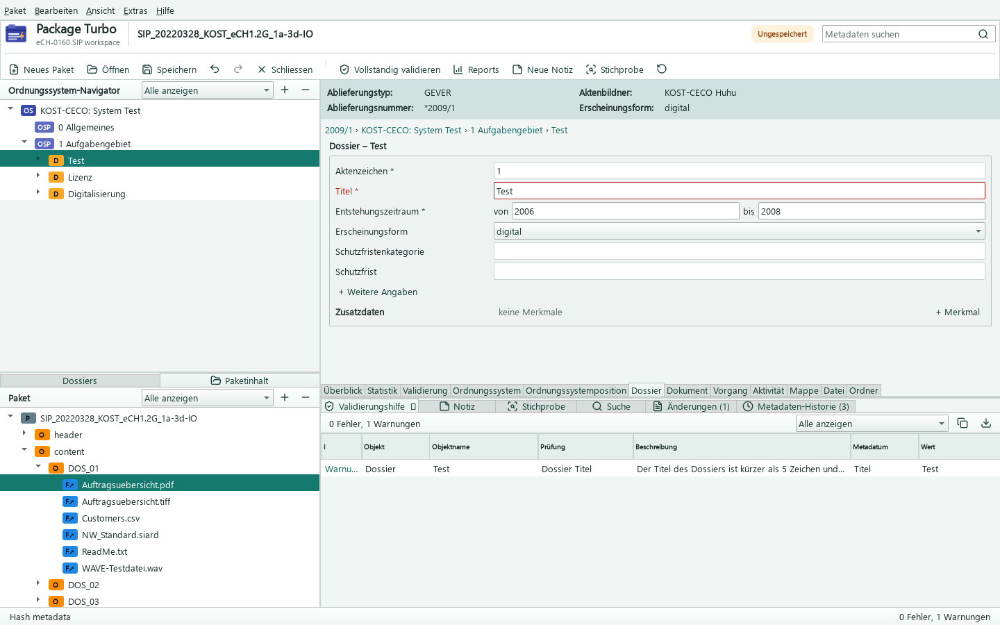

Abweichung: Es gibt keine Toolbar-Schaltflächen für *Ausschneiden/Kopieren/Einfügen*. *Rückgängig* wirkt nur innerhalb eines Feldes; eine übernommene Änderung wird durch erneutes Bearbeiten korrigiert.

### 9.2 Metadaten mehrfach editieren (Massenmutation)

1. Rechtsklick auf ein Objekt im Ordnungssystem-Navigator → *Massenmutation...*.
2. Unter *Betroffene Objekte* den Objekttyp wählen (Ordnungssystemposition, Dossier, Dokument, Mappe oder Datei).
3. Das *Metadatum* wählen und den *Wert* eingeben. Mit *Eintrag in allen Objekten löschen* wird der Eintrag gelöscht.
4. *Fertigstellen*: Die Änderung wirkt sich auf das gewählte Objekt und alle Objekte dieses Typs darunter aus.

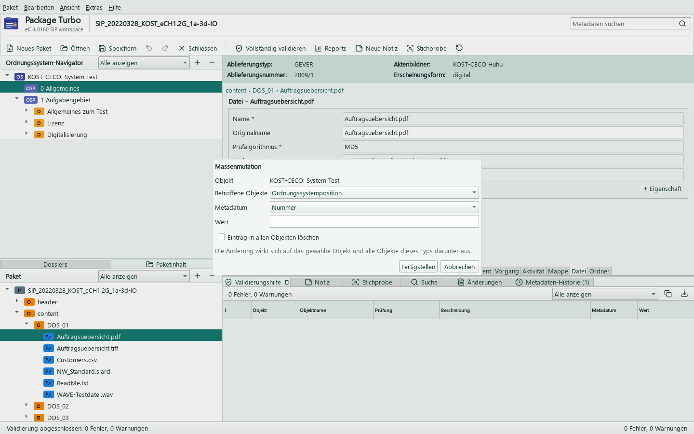

Abweichung: Pro Durchgang wird ein Metadatum eines Objekttyps geändert, statt alle Felder des gewählten Objekts in einem Formular. Pflichtfelder wie Titel oder Aktenzeichen sowie die *Zusatzdaten* können nicht per Massenmutation geändert werden.

### 9.3 Zeitangaben in Package Turbo

| Angabe | Beschreibung |
|---|---|
| Zeiträume | Felder *von* und *bis* mit den Formaten `JJJJ`, `TT.MM.JJJJ` oder `keine Angabe`. Bei geschätzten Angaben wird `ca.` vorangestellt. |
| Zeitpunkte | Formate `JJJJ`, `TT.MM.JJJJ` oder `keine Angabe`, optional mit `ca.` (z. B. Eröffnungsdatum). |
| keine Angabe | Zeigt an, dass die Zeitangabe nicht bekannt ist. Schreibweisen wie *k. A.* oder *s. d.* werden abgelehnt. |

Ungültige Zeitangaben werden mit einer Meldung abgelehnt.

Abweichung: Zusätzlich wird das Format `JJJJ-MM-TT` akzeptiert. Ein leeres *bis*-Feld wird als *keine Angabe* gespeichert.

### 9.4 Zeiträume kumulieren

| Aktion | Vorgehen |
|---|---|
| Zeiträume eines Dossiers kumulieren | Rechtsklick auf ein Dossier oder Subdossier → *Zeiträume kumulieren*. Alle darunterliegenden Angaben werden auf das Dossier kumuliert. |
| Zeiträume auf Stufe Ablieferung kumulieren | Menü *Extras → Zeiträume auf Ablieferung kumulieren*. |

Bei der Kumulierung werden nur konkrete Angaben berücksichtigt; *keine Angabe* wird ignoriert.

### 9.5 Anzeige von Änderungen in den Metadaten

- **Editor:** Ein `*` vor der Ablieferungsnummer (und im Fenstertitel) zeigt ungespeicherte Änderungen an.
- **Aktionsview Änderungen:** Liste aller Änderungen seit dem letzten Speichern mit Zeit, Objekt, Objektname, Metadatum, neuem Wert und gespeichertem Wert. Nach dem Speichern ist die Liste leer.

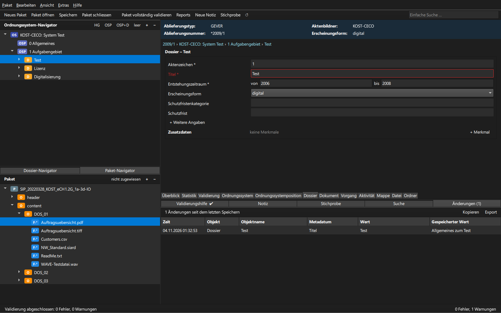

Abweichung: Strukturelle Änderungen (Objekte erstellen, verschieben, löschen, zuweisen) erscheinen ebenfalls in der Liste, mit dem Metadatum *Struktur*.

---

## 10. Ablieferung prüfen und korrigieren

Ein Teil der Prüfungen läuft nach jeder Änderung automatisch. Aufwendigere Prüfungen (z. B. Prüfsummen, Dateisystem) laufen nur bei *Paket vollständig validieren*.

### 10.1 Validierungen durchführen

| Aktion | Vorgehen |
|---|---|
| Paket vollständig validieren | Toolbar *Paket vollständig validieren*, Menü *Extras → Paket vollständig validieren* oder `F5`. Ein Fortschrittsdialog zeigt den Stand; die Validierung kann abgebrochen werden. |
| Beim Öffnen | Beim Öffnen eines Pakets wird die vollständige Validierung angeboten. |

### 10.2 Übersicht über Validierungen

Im Register *Validierung* sind alle Prüfungen mit der Anzahl Fehler und Warnungen aufgelistet. Prüfungen mit Fehlern sind rot hervorgehoben; mit * gekennzeichnete Prüfungen laufen nur bei der vollständigen Validierung. *Anzeigen* filtert die Validierungshilfe auf die Prüfung.

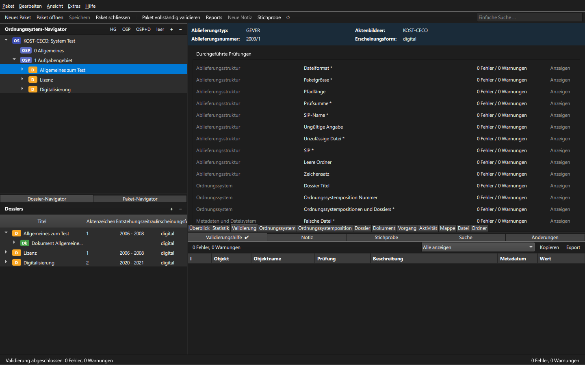

### 10.3 Anzeige von Warnungen und Fehlern: Validierungshilfe

Die Validierungshilfe listet Fehler und Warnungen mit den Spalten *I* (Fehler/Warnung), *Objekt*, *Objektname*, *Prüfung*, *Beschreibung*, *Metadatum* und *Wert*. Über die Auswahlliste wird auf einzelne Prüfungen gefiltert (*Alle anzeigen* hebt den Filter auf); die Anzahl der gefilterten und aller Einträge wird angezeigt. Doppelklick zeigt das Objekt im Editor. Das Kontextmenü enthält die Befehle zur Fehlerbehebung.

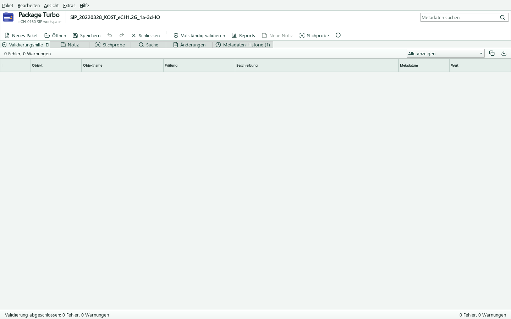

### 10.4 Prüfung der Ablieferungsstruktur

#### 10.4.1 Dateiformat

Package Turbo prüft die Dateien in `content` anhand des **Katalogs archivischer Dateiformate (KaD)** der KOST-CECO (Version 7.1, Bewertungsmatrix):

| Bewertung im KaD | Ergebnis |
|---|---|
| Empfohlen (z. B. PDF/PDF-A, TIFF, JPEG, JPEG2000, WAV, FLAC, MP3, MKV, MP4, ODS, XLSX, XML, SIARD, EML, MBOX, HTML, WARC, WACZ, INTERLIS, DWG, IFC) | keine Meldung |
| Akzeptiert (z. B. TXT, DOCX/PPTX, PNG, CSV, JSON, XLS, MSG, PST, Shapefile, DXF) | keine Meldung |
| Nicht akzeptiert (z. B. ODT/ODP, DNG, MHTML, ARC, STEP) | Fehler |
| Nicht im KaD erfasst | Warnung |

Abweichung: Das Original prüft gegen die Liste archivtauglicher Formate des BAR. Package Turbo verwendet den KaD der KOST-CECO und erkennt Formate nur an der Dateiendung. Varianten mit gleicher Endung (z. B. PDF/A-3 oder GeoTIFF, beide nicht akzeptiert) werden daher wie PDF bzw. TIFF bewertet. Eine Konvertierung wird – wie im Original – nicht angeboten.

#### 10.4.2 Paketgrösse

Prüfung, ob das Paket die maximale Grösse von 8 GB übersteigt. Eine Aufteilung auf mehrere Pakete wird nicht angeboten.

#### 10.4.3 Pfadlänge

Prüfung, ob der Pfad zu einer Datei oder einem Ordner (inkl. Toplevel-Ordner) 180 Zeichen oder mehr umfasst.

| Fehlerbehebung | Vorgehen |
|---|---|
| Einzelne Pfade kürzen | Im Paket-Navigator Rechtsklick → *Umbenennen...*. |
| Alle Pfade kürzen | Menü *Extras → Normalisierung → Pfadlängen bereinigen...* oder Kontextmenü der Fehlermeldung. Ordner werden zu `O1, O2, …`, Dateien zu `P1, P2, …` (die Endung bleibt erhalten). Die Originalnamen bleiben in den Metadaten erhalten. |
| Rückgängig machen | *Extras → Normalisierung → Datei- und Ordnernamen denormalisieren...*. |

Das Paket wird nach diesen Funktionen automatisch gespeichert.

#### 10.4.4 Prüfsumme

Prüfung, ob die in den Metadaten eingetragene Prüfsumme jeder Datei (ausser `metadata.xml`) mit dem Dateiinhalt übereinstimmt. Fehlerbehebung: Rechtsklick auf die Fehlermeldung(en) → *Prüfsumme neu berechnen* (auch für mehrere selektierte Meldungen).

#### 10.4.5 SIP-Name

Prüfung, ob der Name des Toplevel-Ordners dem Muster `SIP_[Ablieferungsdatum]_[Abliefernde Stelle]_Referenz` entspricht. Die Prüfung kann unter *Extras → Benutzervorgaben → SIP-Namen validieren* abgestellt werden. Ein bestehendes Paket wird ausserhalb von Package Turbo umbenannt.

#### 10.4.6 Ungültige Angaben

Prüfung, ob die Schutzfrist eine Ganzzahl ist. Mit Doppelklick auf die Meldung wird das Objekt im Editor angezeigt und kann korrigiert werden.

Abweichung: Weitere Verstösse gegen das XSD (z. B. zu lange Texte, ungültige Datentypen) erscheinen nicht unter *Ungültige Angabe* mit Bezug zum Feld, sondern als technische Meldung unter der Prüfung *Allgemein* (siehe 10.7.10).

#### 10.4.7 Unzulässige Dateien und Ordner

Prüfung, ob sich im Toplevel-Ordner ausschliesslich die Ordner `header` und `content` befinden. Fehlerbehebung: Rechtsklick auf die Meldung → *Im Dateisystem löschen* (nach Bestätigung).

#### 10.4.8 Inhalt Ordner header

Prüfung, ob der Ordner `header` ausschliesslich `metadata.xml` und den Ordner `xsd` mit den XSD-Dateien enthält.

| Fehlerbehebung | Vorgehen |
|---|---|
| Unzulässige Inhalte | Rechtsklick auf die Meldung → *Im Dateisystem löschen*. |
| Fehlende XSD-Dateien | Rechtsklick auf die Meldung → *Ins SIP übernehmen*. Die XSD-Dateien (eCH-0160 v1.2) werden im SIP und im metadata.xml ergänzt. |

#### 10.4.9 Leere Ordner

Prüfung, ob im Paket Ordner ohne Dateien vorhanden sind (Warnung). Doppelklick zeigt den Ordner; Löschen über den Paket-Navigator.

#### 10.4.10 Zeichensatz

Prüfung, ob Datei- und Ordnernamen nur die Zeichen `A–Z a–z 0–9 _ . -` enthalten.

| Fehlerbehebung | Vorgehen |
|---|---|
| Unerlaubte Zeichen ersetzen | Rechtsklick auf die Meldung oder *Extras → Normalisierung → Datei- und Ordnernamen normalisieren...*. Umlaute werden umschrieben (ä → ae), Leerzeichen und andere Zeichen durch `_` ersetzt. |
| Rückgängig machen | *Extras → Normalisierung → Datei- und Ordnernamen denormalisieren...*. |

Abweichung: Die Normalisierung kann jederzeit ausgeführt werden; das Paket wird anschliessend automatisch gespeichert (im Original muss vorher gespeichert werden).

### 10.5 Prüfung des Aufbaus des Ordnungssystems und der Dossierbenennung

#### 10.5.1 Dossier Titel

Warnung, wenn der Titel eines Dossiers aus weniger als 5 Zeichen besteht.

#### 10.5.2 Ordnungssystempositionsnummer

Prüfung, ob die Nummern der Ordnungssystempositionen auf derselben Stufe eindeutig sind.

#### 10.5.3 Ordnungssystempositionen und Dossiers

Prüfung, ob unter einer Ordnungssystemposition sowohl Ordnungssystempositionen als auch Dossiers angehängt sind. Fehlerhafte Objekte werden im Ordnungssystem-Navigator verschoben oder gelöscht.

### 10.6 Prüfung der Entsprechung zwischen Metadaten und Dateisystem

| Prüfung | Was wird geprüft | Fehlerbehebung (Kontextmenü der Meldung) |
|---|---|---|
| Falsche Datei | Im Dateisystem existiert ein Ordner, wo die Metadaten eine Datei aufführen. | *In den Metadaten löschen*, danach den Ordner neu importieren. |
| Falscher Ordner | Im Dateisystem existiert eine Datei, wo die Metadaten einen Ordner aufführen. | *In den Metadaten löschen*, danach die Datei neu importieren. |
| Fehlende Datei | Die Metadaten führen eine Datei auf, die im Dateisystem fehlt. | *In den Metadaten löschen* |
| Fehlender Ordner | Die Metadaten führen einen Ordner auf, der im Dateisystem fehlt. | *In den Metadaten löschen* |
| Überzählige Datei | Eine Datei im Dateisystem ist in den Metadaten nicht aufgeführt. | *Ins Inhaltsverzeichnis übernehmen* oder *Im Dateisystem löschen* |
| Überzähliger Ordner | Ein Ordner im Dateisystem ist in den Metadaten nicht aufgeführt. | *Ins Inhaltsverzeichnis übernehmen* oder *Im Dateisystem löschen* |

Beim Löschen von Dateien in den Metadaten werden auch ihre Zuweisungen entfernt.

### 10.7 Prüfung der Ablieferung auf Vollständigkeit und Plausibilität

| Prüfung | Was wird geprüft | Fehlerbehebung |
|---|---|---|
| 10.7.1 Dokument ohne Dateien | Digitale Dokumente ohne Dateien (Warnung). | Dokument löschen oder Datei zuweisen. |
| 10.7.2 Falsche Zeitraum Angaben | Enddatum vor dem Anfangsdatum. | Doppelklick, im Editor korrigieren. |
| 10.7.3 Fehlende Angaben | Abliefernde Stelle, Ablieferungstyp, Ablieferungsnummer, Schutzfristenkategorie und Schutzfrist (Ablieferung), Aktenbildner, Name des Ordnungssystems, Nummer und Titel der OSP, Titel von Dossiers und Dokumenten. Bei FILES-Ablieferungen sind die Angaben zu OS und OSP Warnungen. | Doppelklick, im Editor ergänzen. Für den Ablieferungstyp: Kontextmenü *Ablieferungstyp setzen*. |
| 10.7.4 Identische Dateien | Dateien mit gleicher Prüfsumme (Warnung). | Doppelklick, Datei im Paket-Navigator löschen. |
| 10.7.5 Keine Zuweisung | Dateien in `content`, die weder einem Dossier noch einem Dokument zugewiesen sind. | Datei zuweisen (8.3.6). |
| 10.7.6 Leere Dossiers | Dossiers und Subdossiers ohne Dateien (Warnung). | Dossier löschen oder Datei zuweisen. |
| 10.7.7 Schutzfrist | Schutzfristenkategorie und Schutzfrist müssen auf Stufe Ablieferung bzw. Dossier beide vorhanden und im Paket einheitlich sein. | Im Editor ergänzen; die Verteilung zeigt das Register *Statistik*. |
| 10.7.8 Zeitraum | Zeiträume von Dossiers und Dokumenten müssen innerhalb des übergeordneten Zeitraums liegen (Warnung). | Im Editor korrigieren oder Kontextmenü *Nach oben übernehmen*; *Extras → Zeiträume auf Ablieferung kumulieren*. |
| 10.7.9 Offener Zeitraum | Dossiers mit *keine Angabe* als *bis*-Datum (Warnung). | Im Editor eine konkrete Angabe erfassen. |
| 10.7.10 Allgemein | Validierung des metadata.xml gegen das XSD im Ordner `header/xsd`. Die technische Meldung beginnt mit «Das Paket entspricht nicht den Anforderungen …» und nennt die Zeile. | Fehler im metadata.xml analysieren. |
| 10.7.11 Gültigkeitsprüfung fehlgeschlagen | Es sind noch Fehler vorhanden. | Sind alle übrigen Fehler behoben, wird angeboten, das Paket zu speichern und erneut vollständig zu validieren. |

Abweichung: Die obligatorischen Metadaten gemäss *Data Dictionary* werden nicht vollständig aus dem XSD abgeleitet, sondern anhand der oben aufgeführten Liste geprüft.

### 10.8 Weitere Hilfsmittel für die Prüfung der Ablieferung

Das Register *Statistik* enthält:

- **10.8.1 Vergleich von Zeiträumen:** Balken für Existenzzeitraum des Aktenbildners, Anwendungszeitraum des Ordnungssystems sowie Entstehungszeiträume der Ablieferung, der Dossiers und der Dokumente. Dunkelblau: eindeutige Angaben; hellblau: mindestens eine Angabe *keine Angabe*; mit Rahmen: offener Anfang oder offenes Ende; kein Balken: keine Angaben.
- **10.8.2 Verteilung von Schutzfristen** auf Stufe Ablieferung, Ordnungssystemposition und Dossier.
- **10.8.3 Statistische Angaben:** Anzahl Ordnungssystempositionen, Dossiers, Dokumente, Mappen und Vorgänge, maximale OSP- und Subdossier-Verzeichnungstiefe, Positionen pro Stufe, Subdossiers pro Stufe, Dokumente nach Anzahl Dateien.
- **10.8.4 Umfang der Ablieferung:** Grösse von metadata.xml, Anzahl Dateien und Umfang der Primärdaten.

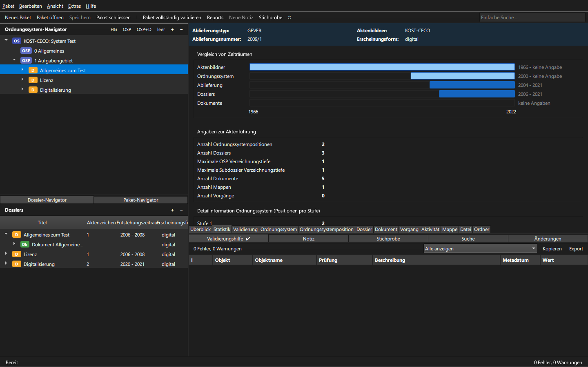

---

## 11. Darstellung von Vorgängen und Aktivitäten

Vorgänge und Aktivitäten (seit eCH-0160 v1.1) werden als Knoten im Ordnungssystem- und Dossier-Navigator dargestellt. Ihre Metadaten sind im Editor ersichtlich, können aber nicht bearbeitet werden (*nur Anzeige*). Sie können nicht erstellt oder gelöscht werden. Die Suche berücksichtigt auch ihre Metadaten.

---

## 12. Darstellung von Mappen

Mappen (seit eCH-0160 v1.2) werden im Ordnungssystem- und Dossier-Navigator dargestellt. Sie können im Ordnungssystem-Navigator erstellt, verschoben und gelöscht werden; die Metadaten sind im Editor bearbeitbar und stehen für die Massenmutation und die Suche zur Verfügung.

> **Tipp:** Mappen werden vom BAR nicht zugelassen und dürfen in einer Ablieferung an das BAR nicht vorkommen. Ablagen sind durch Ordnungssystempositionen und Dossiers zu strukturieren.

---

## 13. Metadaten suchen

Package Turbo bietet die *einfache Suche* (über alle Metadaten) und die *erweiterte Suche* (gezielt nach Metadaten eines Objekttyps). Gesucht wird nach dem eingegebenen Begriff als Teilzeichenkette ohne Ersatzzeichen und ohne Unterscheidung von Gross- und Kleinschreibung. In den Primärdaten wird nicht gesucht.

### 13.1 Einfache Suche

#### 13.1.1 Eine einfache Suche machen

1. Suchbegriff im Feld *Einfache Suche* der Toolbar eingeben und `Enter` drücken, oder *Extras → Suche...* (`Ctrl+F`) wählen.
2. In der Aktionsview *Suche* das Register *Einfache Suche* verwenden und *Suchen* klicken.

#### 13.1.2 Fehlermeldung bei der einfachen Suche

Ohne Treffer erscheint die Meldung *Keine Treffer*; das bisherige Resultat bleibt angezeigt. Ohne Suchbegriff wird zur Eingabe aufgefordert.

Abweichung: Der Dialog *Keine Treffer* hat nur *OK* (keine Schaltflächen *Neue Suche* / *Suche abbrechen*); der Suchbegriff bleibt im Feld erhalten.

#### 13.1.3 Anzeige der Resultate der einfachen Suche

Spalten: *Objekt*, *Objektname*, *Metadatum*, *Wert*. Die Anzahl Objekte wird angezeigt.

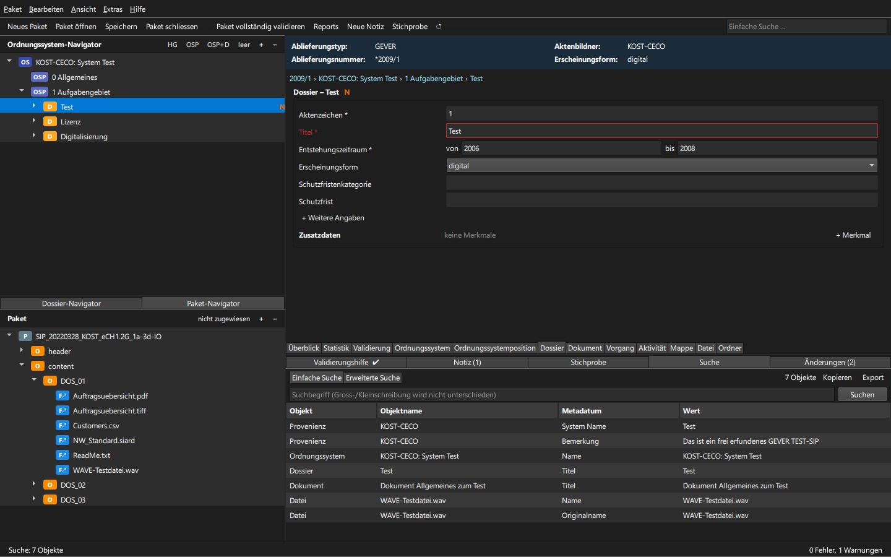

### 13.2 Erweiterte Suche

#### 13.2.1 Eine erweiterte Suche durchführen

1. In der Aktionsview *Suche* das Register *Erweiterte Suche* wählen.
2. Pro Suchkriterium *Objekt*, *Metadatum* und *Wert* eingeben (höchstens 3 Kriterien, mit UND kombiniert). Als Metadatum steht auch *Zusatzdaten* zur Verfügung (gesucht wird in Name und Wert der Merkmale). Für die Suche nach leeren Feldern *Leerfeld* aktivieren.
3. *Suchen* klicken. Mit ✕ wird ein Suchkriterium entfernt.

#### 13.2.2 Fehlermeldung bei der erweiterten Suche

Ohne Treffer erscheint *Keine Treffer*. Kriterien mit unterschiedlichen Objekttypen ergeben keine Treffer.

Abweichung: Unvollständige Kriterien (ohne Objekt oder Metadatum) werden ignoriert statt mit einer Meldung abgelehnt.

#### 13.2.3 Anzeige der Resultate der erweiterten Suche

Spalten: *Objekt*, *Objektname* und je eine Spalte pro Suchkriterium mit der Bezeichnung des Metadatums. Bei der Leerfeldsuche bleibt die Spalte leer.

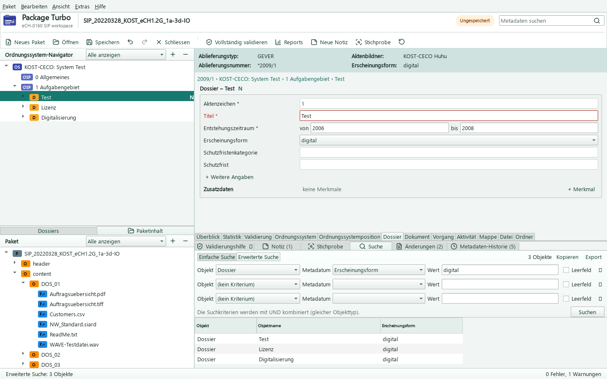

### 13.3 Anzeige der Suchresultate einschränken

Die *Maximale Anzahl Treffer* (Standard 15 000) wird unter *Extras → Benutzervorgaben → Suche* festgelegt. Ergibt eine Suche mehr Treffer, wird eine Meldung angezeigt und kein Resultat aufgelistet.

---

## 14. Weitere Werkzeuge für die Bearbeitung der Ablieferung

### 14.1 Notizen

Notizen werden als `archivischeNotiz` in den Metadaten gespeichert und bleiben im Paket erhalten. Vor der Ablieferung an das Archiv sollten alle Notizen gelöscht werden.

#### 14.1.1 Notizen erfassen

| Aktion | Vorgehen |
|---|---|
| Notiz zu Objekten in den Navigatoren | Rechtsklick → *Neue Notiz...*, Text eingeben, *OK*. Mit `Ctrl`+Klick oder `Shift`+Klick können mehrere Objekte gewählt werden. |
| Notiz zu Ablieferung, Provenienz und Paket | Im Register *Überblick* Rechtsklick auf die Titelzeile des Bereichs → *Neue Notiz...*. |
| Notiz zum aktuellen Objekt | Toolbar *Neue Notiz*. |

Im Paket-Navigator können Notizen nur zu Dateien erfasst werden.

Abweichung: Notizen sind nur für Objekte möglich, die gemäss XSD eine `archivischeNotiz` haben dürfen (nicht für Ordner, Mappen, Vorgänge und Aktivitäten). Der Befehl ist bei diesen Objekten ausgegraut.

#### 14.1.2 Markierung der Objekte mit Notizen

Objekte mit Notizen sind in den Navigatoren und im Editor mit einem orangen **N** markiert.

#### 14.1.3 Anzeige der Notizen

Die Aktionsview *Notiz* zeigt *Objekt*, *Objektname*, *Kommentar*, *Erstellungsdatum* und *Erfasst durch*.

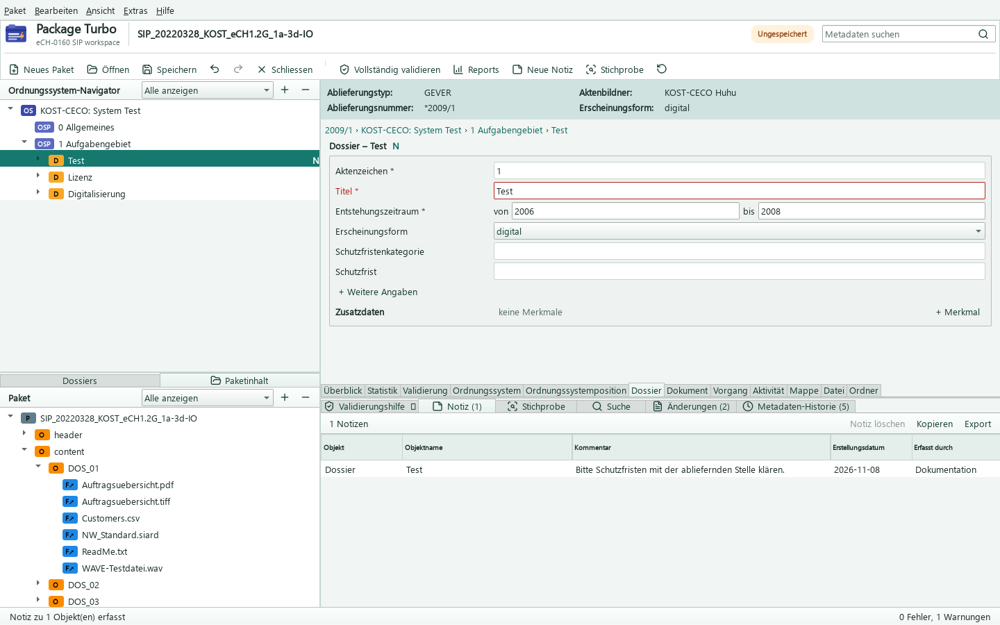

#### 14.1.4 Anzeige der Notizen von den Objekten aus

Rechtsklick auf ein markiertes Objekt (bzw. auf die Titelzeile im Register *Überblick*) → *Gehe zu Notiz*. Die Notiz wird in der Aktionsview *Notiz* markiert.

#### 14.1.5 Notizen bearbeiten und löschen

| Aktion | Vorgehen |
|---|---|
| Bearbeiten | Rechtsklick auf die Notiz in der Aktionsview → *Notiz bearbeiten...*. |
| Löschen | Rechtsklick → *Notiz löschen* oder Schaltfläche *Notiz löschen*; die Löschung wird bestätigt. |

### 14.2 Stichprobe

#### 14.2.1 Stichprobe definieren und vornehmen

Unter *Extras → Benutzervorgaben → Stichprobe* werden die Art der Beschränkung (*absolut* oder *in Prozent*) und der Umfang festgelegt (Standard: absolut, 10 Dossiers). *Neue Auswahl* in der Aktionsview *Stichprobe*, *Extras → Stichprobe: Neue Auswahl* oder die Toolbar *Stichprobe* nimmt eine neue Stichprobe vor.

#### 14.2.2 Anzeige der Resultate der Stichprobe

Die Aktionsview *Stichprobe* zeigt *Objekt*, *Aktenzeichen* und *Titel* der ausgewählten Dossiers (ohne Subdossiers).

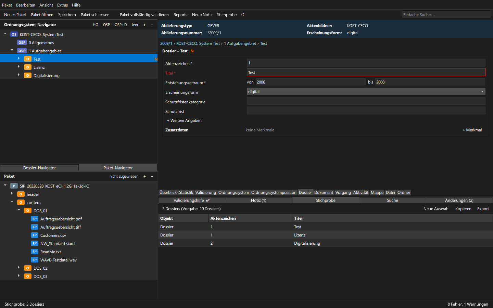

Abweichung: Die Stichprobe wird nicht automatisch beim Öffnen gezogen, sondern erst mit *Neue Auswahl*.

---

## 15. Berichte erstellen

Über *Paket → Reports* oder die Toolbar *Reports* werden drei Berichte als PDF erstellt:

- **Ordnungssystem**: alle Ordnungssystempositionen mit Nummern und Titeln.
- **Dossierverzeichnis**: alle Dossiers mit Aktenzeichen, Titel, Entstehungszeitraum und Form.
- **Ablieferungsverzeichnis**: alle Ordnungssystempositionen mit den Dossiers.

Alle Berichte enthalten ein Deckblatt mit Aktenbildner, abliefernder Stelle, Ablieferungs- und Angebotsnummer, Ablieferungstyp, Schutzfristen, statistischen Angaben, Datum und dem Namen des Report-Herstellers (*Extras → Benutzervorgaben → Berichte*).

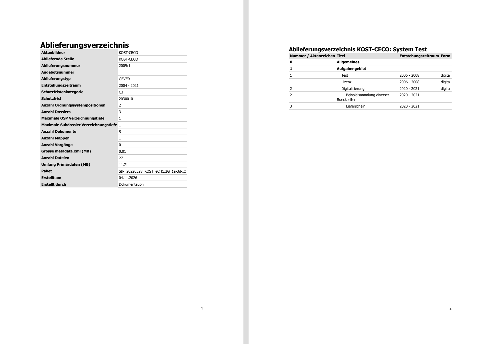

Abweichung: Der Bericht wird zuerst gespeichert und danach im PDF-Programm des Betriebssystems geöffnet, nicht in einem eigenen Viewer.

---

## 16. Package Turbo einrichten

### 16.1 Anordnung und Grösse von Navigatoren und Aktionsviews ändern

| Aktion | Vorgehen |
|---|---|
| Grösse ändern | Trennlinien zwischen den Bereichen ziehen. Die Grösse bleibt nach einem Neustart erhalten. |
| Bereich maximieren / wiederherstellen | Doppelklick auf den Titel des Navigators, die Kopfzeile des Editors oder das Register *Validierungshilfe*. |
| Anordnung speichern | *Ansicht → Perspektive speichern als...* und einen Namen eingeben. |
| Perspektive anzeigen | *Ansicht → Perspektive öffnen* und die Perspektive wählen. |
| Perspektive löschen | *Ansicht → Perspektive löschen*. |

Abweichung: Navigatoren und Aktionsviews können nicht verschoben werden; eine Perspektive speichert nur die Grössen der Bereiche. Es gibt keine Standard-Perspektive und keine Symbole für Perspektiven in der Toolbar.

### 16.2 Grundeinstellung wiederherstellen

Mit ↺ in der Toolbar oder *Ansicht → Perspektive zurücksetzen* wird die Grundeinstellung der Benutzeroberfläche wiederhergestellt.

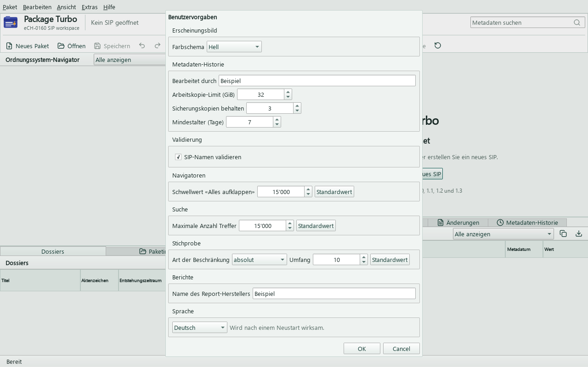

---

## 17. Tabellenspalten konfigurieren und sortieren

Die Tabellen der Aktionsviews können sortiert und konfiguriert werden:

| Aktion | Vorgehen |
|---|---|
| Sortierung aktivieren | Klick auf einen Spaltentitel. Weitere Spalten werden mit Klick als nachrangige Sortierung hinzugefügt; die Priorität wird als Zahl neben dem Pfeil angezeigt. |
| Richtung ändern | Erneuter Klick auf einen sortierten Spaltentitel (▲ aufsteigend, ▼ absteigend). |
| Priorität senken / erhöhen | `Ctrl`+Klick bzw. `Shift`+Klick auf den Spaltentitel. |
| Sortierung aufheben | `Alt`+Klick auf den Spaltentitel. |
| Spalten ein- und ausblenden | Rechtsklick auf einen Spaltentitel und die Spalten an- bzw. abwählen. |

Abweichung: Der Dossier-Navigator kann nicht sortiert und seine Spalten können nicht ausgeblendet werden. Die Spaltenreihenfolge kann nicht verändert werden.

---

## 18. Tabellen nach Excel exportieren

| Aktion | Vorgehen |
|---|---|
| Selektierte Zeilen kopieren | Zeilen selektieren (`Shift`/`Ctrl`+Klick), dann *Kopieren* in der Aktionsview, `Ctrl+C` oder Rechtsklick auf einen Spaltentitel → *Die selektierten Zeilen in die Zwischenablage kopieren*. Ohne Selektion werden alle Zeilen kopiert. Im Dossier-Navigator über das Kontextmenü. In Excel mit *Einfügen* übernehmen. |
| Ganze Tabelle exportieren | *Export* in der Aktionsview speichert die Tabelle als CSV-Datei, die direkt in Excel geöffnet werden kann. |

Symbole (Fehler, Warnungen, Objekte) werden als Text exportiert.

Abweichung: Zusätzlich zur Zwischenablage gibt es den Export als CSV-Datei (Trennzeichen `;`, UTF-8).

---

## 19. Hilfe

### 19.1 Menü Hilfe

#### 19.1.1 Benutzerdokumentation

*Hilfe → Benutzerdokumentation* oder `F1` öffnet die Benutzerdokumentation.

Abweichung: Geöffnet wird die Benutzerdokumentation des Original-Package-Handlers (PDF im Projektordner) bzw. deren Markdown-Fassung, nicht diese Dokumentation.

#### 19.1.2 Informationen zur Tastenbelegung

*Hilfe → Hilfe für die Tastenbelegung anzeigen* zeigt die Tastenkombinationen:

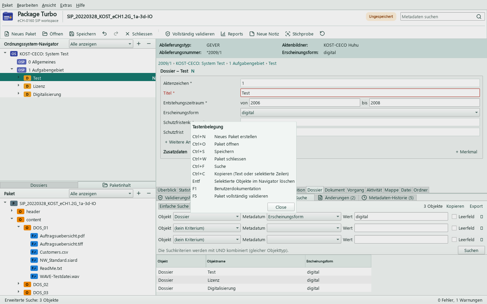

#### 19.1.3 Informationen zu Package Turbo

*Hilfe → Über Package Turbo* zeigt Version, unterstützte Standardversion und die Quelle der Formatbewertung.

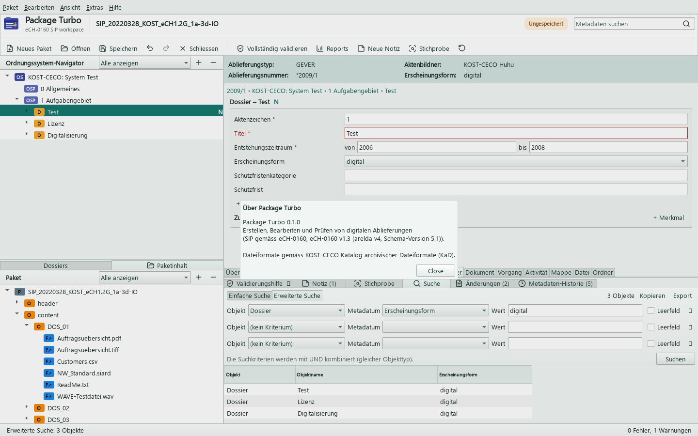

### 19.2 Tooltips

| Tooltip | Inhalt |
|---|---|
| Befehlsinformation | Erklärung der Befehle im Viewmenü der Navigatoren und in den Aktionsviews. |
| Register des Editors | Welche Informationen das Register abdeckt. |
| Metadaten im Register | Beschreibung des Metadatums. |
| Fehlerhafte Metadaten | Die Fehlermeldung der Validierung. |
| Nicht ganz angezeigter Spalteninhalt | Der vollständige Inhalt der Zelle. |
| Spaltentitel | Bedienung der Sortierung. |

---

## 20. Übersicht Befehle

| Befehl | Ort |
|---|---|
| Neues Paket erstellen | Toolbar, Menü *Paket*, `Ctrl+N` |
| Paket öffnen / schreibgeschützt öffnen | Toolbar, Menü *Paket*, `Ctrl+O` |
| Speichern | Toolbar, Menü *Paket*, `Ctrl+S` |
| Paket schliessen | Toolbar, Menü *Paket*, `Ctrl+W` |
| Paket vollständig validieren | Toolbar, Menü *Extras*, `F5` |
| Reports | Toolbar, Menü *Paket* |
| Neue Notiz | Toolbar, Kontextmenüs |
| Stichprobe (Neue Auswahl) | Toolbar, Menü *Extras*, Aktionsview *Stichprobe* |
| Suche | Toolbar (Feld), Menü *Extras*, `Ctrl+F` |
| Perspektive zurücksetzen | Toolbar (↺), Menü *Ansicht* |
| Normalisierung | Menü *Extras*, Kontextmenü der Validierungshilfe |
| Nur Hauptgruppen / OSP / OSP mit Dossiers / leere Dossiers | Viewmenü Ordnungssystem-Navigator (*HG*, *OSP*, *OSP+D*, *leer*) |
| Nur nicht zugewiesene Dateien | Viewmenü Paket-Navigator (*nicht zugewiesen*) |
| Alles aufklappen / zuklappen | Viewmenü der Navigatoren (*+*, *−*) |
| Die selektierten Zeilen in die Zwischenablage kopieren | Aktionsviews (*Kopieren*), Kontextmenü Dossier-Navigator |
| Notiz löschen | Aktionsview *Notiz* |

---

## 21. Objekte in Package Turbo

Objekte werden mit farbigen Kürzeln gekennzeichnet:

| Kürzel | Bedeutung |
|---|---|
| **P** | Paket |
| **A** | Ablieferung |
| **Pv** | Provenienz |
| **OS** | Ordnungssystem |
| **OSP** | Ordnungssystemposition |
| **D** | Dossier |
| **SD** | Subdossier |
| **Dk** | Dokument |
| **V** | Vorgang |
| **Ak** | Aktivität |
| **M** | Mappe |
| **F** | Datei (**F↗** = zugewiesen) |
| **O** | Ordner |
| **N** | Objekt mit Notiz |

Abweichung: Statt der Icons des Originals werden farbige Textkürzel verwendet. Die Register *Überblick*, *Statistik* und *Validierung* haben kein eigenes Symbol.
