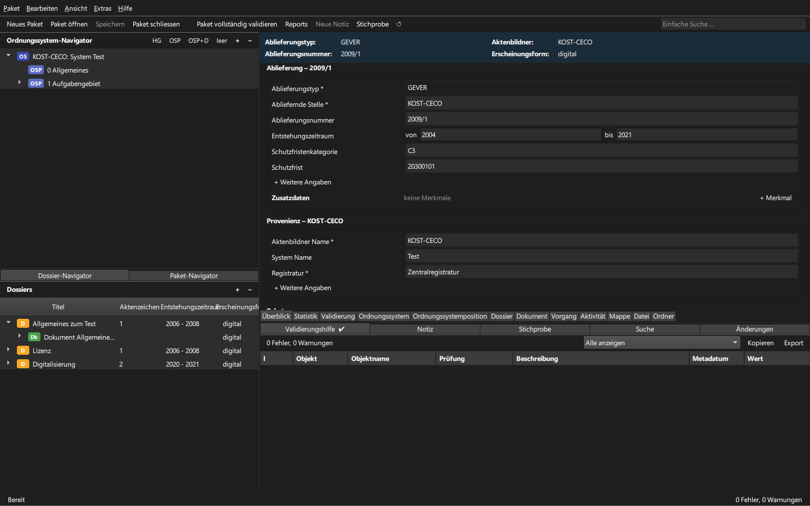

# package-turbo

<p align="center">
  
</p>

An experimental reimplementation of the Swiss Federal Archives' Package Handler
for eCH-0160 Submission Information Packages (SIPs). This project is for
educational purposes and is not intended for production use.

## Features

- Open and create eCH-0160 SIPs (versions 1.0, 1.1, and 1.2).
- Browse package structure, edit metadata, and open content files.
- Validate metadata against the package's XML schemas and assist with corrections.
- Search metadata, add notes, and create samples.
- View reports and statistics, and export tables to Excel.

## Run

Requires Python 3.11 or newer.

```sh
pip install .
package-turbo
```

See the [user guide](docs/user-guide/Benutzerdokumentation.md) for details.

## Sample SIP files

Sample SIPs are available from [KOST/CECO](https://kost-ceco.ch/cms/ech-0160-archivische-ablieferungsschnittstelle.html).